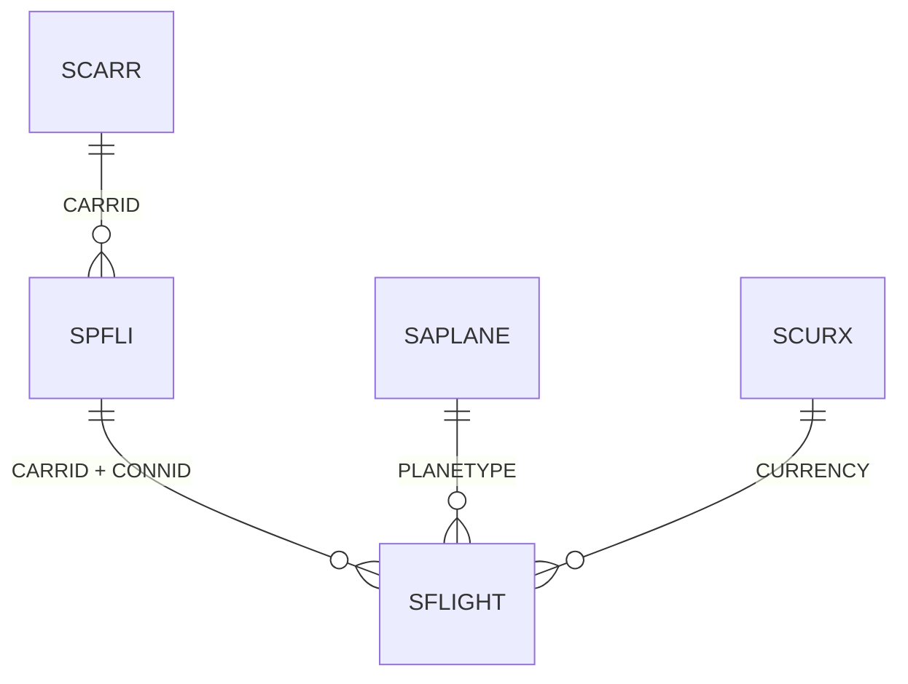

# ABAP Technical Design

**Request ID**: REQ-002-zflight-report
**Date**: 2026-10-12
**Author**: ZCode session (main agent)
**Status**: Implemented

---

## 1. Overview

### 1.1. Business Requirement

A read-only report over the standard flight table `SFLIGHT` on the development system, runnable
directly from SE38/SA38 with a selection screen and ALV output. Details and acceptance criteria:
[01_srs.md](01_srs.md).

### 1.2. Scope

In scope: report `ZFLIGHT` (selection screen, ordered read, SALV ALV). Out of scope: authority
check, transportable packaging, CDS/RAP layer, booking drilldown — see SRS §2.

---

## 2. Architecture Decision

### 2.1. Pattern Selection

| Criteria | Decision | Rationale |
|----------|----------|-----------|
| Pattern | **Pattern A: New Object** — classic report with SALV ALV | Smallest artifact that runs standalone in SE38/SA38; no service/UI infrastructure needed for a read-only demo (D1) |
| Package | `$TMP` (local) | Inside the allowed-package ceiling (`SAP_ALLOWED_PACKAGES=Z*,$TMP,$ZADT_VSP,$VSP_ADT`); no transport required for demo use (D2) |
| Transport | none | `$TMP` objects do not transport; re-create in a Z* package if promotion is decided |

Key decisions: SALV (`CL_SALV_TABLE=>FACTORY`) over WRITE list / CL_GUI grid (D5); selection
ranges plus explicit `UP TO p_max ROWS` cap (D3); default `CARRID EQ 'LH'` for a meaningful
first run (D4); `PRICE`/`PAYMENTSUM` bound to `CURRENCY` as ALV currency reference (D6); the
create went through the SAP MCP proxy approval flow — R2 `create`, approval
`db4888ab114f87e4`, human-approved, identical retry forwarded once (D7).

### 2.2. Object List

| Object Type | Name | Description |
|-------------|------|-------------|
| Report | `ZFLIGHT` | SFLIGHT query with selection screen and SALV ALV output |
| CDS View | — (none) | Not required; direct Open SQL on the demo model |
| Table | — (none) | Reads standard `SFLIGHT` only |
| Function Module | — (none) | Standalone report |
| Authorization | — (none) | No `AUTHORITY-CHECK` in this version — see SRS open question 2 |

---

## 3. Database Design

### 3.1. ERD (read path)

### 3.2. Table Definitions

Read table: standard `SFLIGHT` (transparent, delivery class A) — key `MANDT`, `CARRID`,
`CONNID`, `FLDATE`; selected fields `PRICE`, `CURRENCY`, `PLANETYPE`, `SEATSMAX`, `SEATSOCC`,
`SEATSMAX_B`, `SEATSOCC_B`, `SEATSMAX_F`, `SEATSOCC_F`, `PAYMENTSUM`. No new DDIC objects.

### 3.3. Data Access Strategy (CDS-First)

> See [Data Access Rules DA-1..DA-8](../../docs/co-abap.context.md#data-access-rules-cds-first--sql-quality).

- **System release (DA-1)**: AS ABAP 7.52 (NPL developer edition) — not an S/4HANA VDM system
- **Applicability (DA-2)**: [x] ECC/non-VDM (Open SQL)

| Level | Option | Candidate Object(s) | C1 verified (how / result) | Used? | Rationale |
|-------|--------|---------------------|----------------------------|-------|-----------|
| 1 | Released standard CDS (`I_*`) | none for flight demo model on this release | n/a | No | No released flight CDS available on 7.52 developer system |
| 2 | Custom CDS (`ZI_` / `ZR_` / `ZC_`, DA-8) | — | N/A | No | Unnecessary indirection for a single-table demo read |
| 3 | Open SQL with DB pushdown | `SELECT ... FROM sflight` | yes — full-key-capable WHERE on primary key fields | **Yes** | Single table, selective key fields, ordered read |
| 4 | AMDP | — | N/A | No | No pushdown need beyond what Open SQL provides |

- [x] DA-4 SQL quality baseline reviewed for written/modified statements (explicit field list, host-variable binding, no `SELECT *`)
- [ ] DA-5 DCL (`#CHECK`) — N/A (no CDS view)
- [ ] DA-6 conversion evidence — N/A (no data conversion)

### 3.4. Index Recommendations

| Index | Fields | Rationale |
|-------|--------|-----------|
| — (none) | — | All selection fields are primary-key-leading; primary index suffices at 94 rows |

---

## 4. Interface Design

None — standalone report without FMs, BAPIs or CDS/OData exposure.

---

## 5. Implementation Sequence

| Step | Action | Depends On | Status (2026-10-12) |
|------|--------|-----------|---------------------|
| 1 | Create `ZFLIGHT` via SAP MCP proxy (R2 create, human approval `db4888ab114f87e4`) | — | done |
| 2 | Activation | Step 1 | done — 0 messages |
| 3 | Source read-back verification | Step 2 | done — matches submitted source |
| 4 | First report run in SE38/SA38 (manual) | Step 2 | open — user-side |

---

## 6. Quality Gates

| Gate | Check | Command | Result |
|------|-------|---------|--------|
| Syntax | activation check on create | SAP MCP `create` (activates) | pass — 0 messages |
| Unit Test | not applicable | — | no test include (report without class-based tests) |
| ATC | not yet run | SAP MCP `test` (RunATCCheck) | open |

---

## 7. Impact Analysis

### 7.1. Affected Objects

None — new standalone local object; no standard objects modified or enhanced.

### 7.2. Regression Risk

None — read-only report on demo data in `$TMP`; deletion of the object has no system impact.

---

## 8. Open Questions

| # | Question | Resolution |
|---|----------|-----------|
| 1 | Promote to transportable Z* package? | Pending decision — SRS open question 1 |
| 2 | Add `AUTHORITY-CHECK` for wider rollout? | Pending decision — SRS open question 2 |
